# CPEOPS Midterm Project: Introduction to Linux Kernel Modules

> [!info] Document Reference
> Based on the reference document: "CPEOPS-midterm-project-2026.docx.
> **Context:** Operating Systems – Programming Project (pp. 134-140 P-2 Chapter 2 Operating Systems Services)

> [!calendar] Important Dates
> - **Deadline:** October 19, 2026.
> - **Presentation of Output:** October 19 - 23, 2026.

## 8📖 Introduction
This project focuses on the development, compilation, loading, and removal of Linux kernel modules.
* A kernel module is a piece of code that can be loaded into the Linux kernel while the operating system is running.
* This provides a relatively simple way to interact directly with kernel functions and information.
* The project introduces the `/proc` file system, which is a pseudo file system maintained in kernel memory commonly used to query kernel and process-related information.
* Throughout the project, a simple kernel module was created and tested, then modified to access kernel-specific information such as `GOLDEN_RATIO_PRIME`, the greatest common divisor of two numbers, `jiffies`, and `HZ`.
* A `/proc/hello` entry was also created to demonstrate communication between kernel space and user space.

## 🎯 Project Objectives
The main objectives of this project were:
- [ ] To understand the basic structure of a Linux kernel module.
- [ ] To create and compile a simple kernel module.
- [ ] To load a kernel module using `insmod`.
- [ ] To verify loaded modules using `lsmod`.
- [ ] To remove a kernel module using `rmmod`.
- [ ] To view kernel messages using `dmesg`.
- [ ] To access kernel-specific constants and functions.
- [ ] To print the value of `GOLDEN_RATIO_PRIME`.
- [ ] To calculate the greatest common divisor of 3,300 and 24.
- [ ] To understand the purpose of `jiffies` and `HZ`.
- [ ] To create an entry in the `/proc` file system.
- [ ] To read information from a custom `/proc` file.
- [ ] To understand how kernel-space data can be transferred to user space.

*(Note: The project instructions specifically require the module to be loaded and unloaded, followed by exercises involving `GOLDEN_RATIO_PRIME`, GCD, `jiffies`, and `HZ`.*

## 🛠️ Environment & Tools
* **Operating System:** Linux OS.
* **Programming Language:** C programming language.

## ⚠️ Problems and Considerations

> [!warning] Safety Precaution
> Because kernel modules execute within the kernel, errors in kernel code can potentially affect the entire operating system. For this reason, the project was performed in a Linux virtual machine.

**Development Best Practices:**
* **Compile Frequently:** Compilation should be performed frequently using `make`. This helps identify errors before additional changes are made.
* **Check Logs:** The kernel log should also be checked using `dmesg` after loading and removing the module.
## 📸 Execution & Results

### 1. C Source Code & Makefile
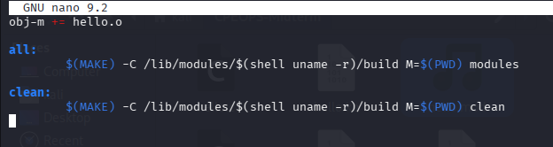

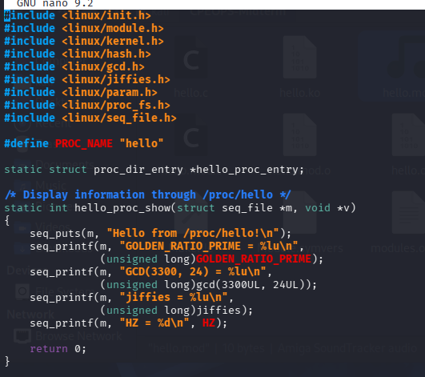

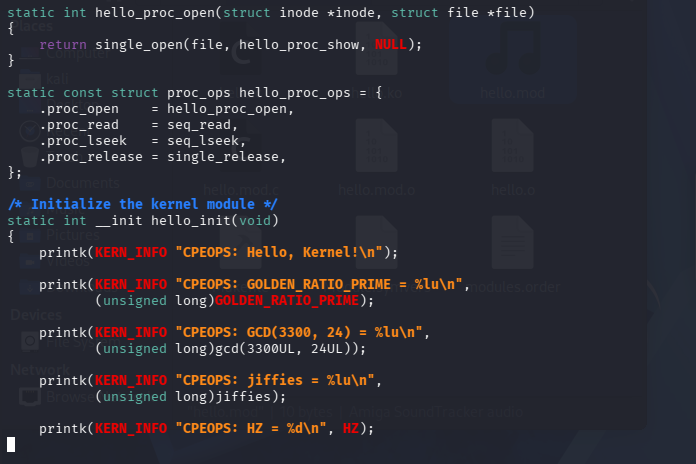

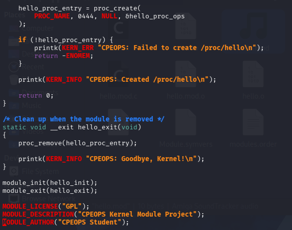
### 2. Compilation 

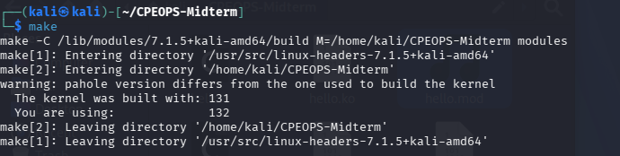
### 3. Module Loading & Verification

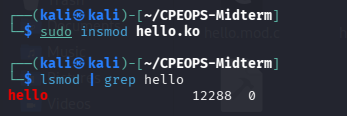
### 4. Kernel Messages (Initialization & Values)

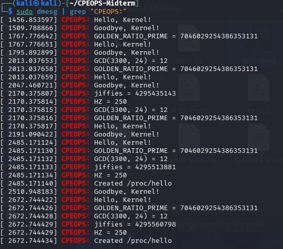

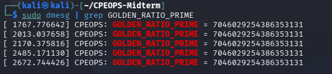

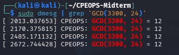
### 5. User Space Communication

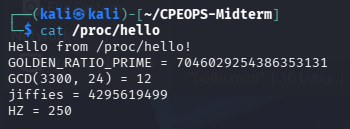
### 6. Module Removal

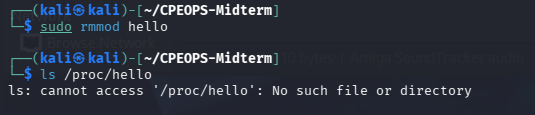
